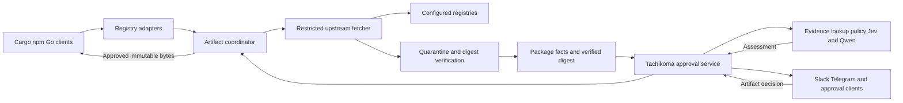

# Registrygate architecture

Status: proposed architecture. Implementation priority: Cargo, npm, Go, then
Python. Registrygate is a self-contained Rust service in its own repository.
It serves package downloads and can request decisions from an independent
approval service through a versioned API. Ordinary package-manager
commands use configured local registry endpoints. OpenSnitch continues to
handle network connections independently.

The reusable unit is an artifact with a verified byte digest. Registry adapters
translate native protocols into that unit; shared code handles fetching,
quarantine, local verification, decision enforcement, caching, and delivery.
The approval service owns risk policy, AI assessment and human review. An artifact
approval never creates a firewall permission.

## Service architecture



The Registrygate executable is `registrygate`, independently supervised and
released from `noeljackson/registrygate`. Snitchgate is a separate producer of
network reviews. `noeljackson/tachikoma` owns the approval service, its versioned
API schema and client SDK. A slow registry or
artifact assessment must not consume the network queue or extend an OpenSnitch
request deadline.

Registrygate depends on an `ApprovalBackend` contract, not Snitchgate Rust types
or executables. A local backend supports explicit local rules and observation;
a remote backend connects to the central approver. Selecting manual mode without
a human-capable backend is a configuration error. Losing a configured remote
backend never selects a permissive local fallback automatically.

Clients connect directly to the configured gateway; it establishes HTTPS to
approved upstreams. A workstation starts with loopback listeners. A shared
deployment requires TLS and authenticated clients. There is no universal HTTPS
inspection or machine-wide certificate replacement in this design.

## Registry support and delivery order

| Priority | Adapter | Protocol responsibilities | Artifact identity |
| --- | --- | --- | --- |
| First group | Cargo | Sparse index, index configuration, crate downloads, validators and yanked state | Registry, crate, exact version, crate digest |
| First group | npm | Package metadata, version metadata, scoped names, tarball URLs, declared audit queries | Registry, scope/name, exact version, tarball digest |
| First group | Go | Module proxy endpoints and approved checksum-database forwarding | Registry, module path, exact version, module ZIP digest |
| Next | Python | Simple API HTML and JSON, file links, hashes and distribution metadata | Registry, normalized project, version, wheel/sdist filename and digest |
| Later | Maven | Repository layout, POMs, metadata, classifiers and snapshots | Repository, group/artifact/version, classifier, extension and digest |
| Later | NuGet | V3 service discovery, registrations and package content | Feed, normalized package/version and package digest |
| Separate later phase | OCI | Manifest graphs, blobs, platform selection and registry authentication | Registry, repository, manifest digest and platform |

Adapters preserve their protocols rather than forcing all version strings into
SemVer. OCI has a manifest graph and layer model; it shares storage and evidence
interfaces but needs graph-aware authorization before support is claimed.

### Cargo

Expose a sparse index and configure Cargo source replacement. Preserve index
entries, dependency constraints, checksums, features, and yanked state. Point
the index's download configuration at the gateway, then gate `.crate` delivery.
Source replacement requires equivalent source contents; denial must be explicit
rather than silently substituting a patched crate. [Index format](https://doc.rust-lang.org/cargo/reference/registry-index.html),
[source replacement](https://doc.rust-lang.org/cargo/reference/source-replacement.html).

Public upstreams initially are `index.crates.io` and `static.crates.io`. Match
downloaded bytes against the index SHA-256 checksum. Publishing and legacy Git
index support are outside the first release.

### npm

Allow bounded metadata resolution and gate the selected tarball. Resolve scoped
names and associate each download with its version metadata; filenames alone
are insufficient identity evidence. Rewrite approved download links back to the
gateway while preserving package contents and integrity information. Preserve
client signature verification endpoints where supported.
[Registry API](https://github.com/npm/registry/blob/main/docs/REGISTRY-API.md).

Default-registry lockfiles can follow a configured registry, while custom
registry URLs may remain pinned. Test both; never advertise complete coverage
from a config setting alone. Define any npm audit POST operations explicitly
as bounded queries; reject publishing and unknown write operations.
[Registry configuration](https://docs.npmjs.com/misc/registry/).

### Go

Support version lists, latest-version metadata, `.info`, `.mod`, and `.zip`
endpoints with native path escaping. Gate ZIP delivery and preserve returned
module bytes. Forward approved checksum-database protocol responses unchanged;
retain normal client checksum verification. A raw ZIP SHA-256 is not Go's
`h1` directory hash, and must not be presented as checksum-database verification.

Return an explicit denial, not a synthetic 404/410 that invites fallback.
Enforced deployments must remove alternative/direct proxy fallbacks. Treat
private-module bypass configuration as an explicit coverage boundary.
[Go module proxy protocol](https://go.dev/ref/mod#goproxy-protocol).

### Python and later adapters

Python follows after the first three, implementing the Simple API's HTML/JSON
negotiation and routing distribution links through the gateway. Different
wheels and source distributions of one version are separate artifacts.
[Simple API](https://packaging.python.org/en/latest/specifications/simple-repository-api/).

Maven needs coordinates including classifier and extension; NuGet discovers
package endpoints through its service index. Neither can be modeled as a bare
`name@version` URL. [Maven layout](https://maven.apache.org/repositories/layout.html),
[NuGet package content](https://learn.microsoft.com/en-us/nuget/api/package-base-address-resource).

OCI support must preserve content-addressed manifests and authorize required
child manifests/layers as an explicit graph. Container vulnerability assessment
needs image inventory, not a package-version lookup alone.
[OCI distribution specification](https://github.com/opencontainers/distribution-spec/blob/main/spec.md).

## Shared domain model

Keep these records separate:

| Record | Required meaning |
| --- | --- |
| `RegistryId` | Administrator-defined registry plus upstream and authentication realm |
| `PackageCoordinate` | Ecosystem-native namespace/name and exact version, retaining original spelling |
| `ArtifactDescriptor` | Coordinate, variant/filename, approved origin reference and expected integrity |
| `VerifiedArtifact` | Immutable quarantine object, computed digest, size and integrity evidence |
| `EvidenceSnapshot` | Findings, explicit provider outcomes, timestamps and scanner/database versions |
| `ArtifactReview` | Immutable subject, evidence snapshot, policy revision, deadline and requester realm |
| `ArtifactGrant` | Exact review subject, action, actor, use scope, expiry and consumption state |

Use package URLs where useful for advisory interchange, while keeping the
original coordinates and ecosystem-specific qualifiers. Registry identity and
private authentication realm are always part of the scope. Mutable references
such as `latest`, ranges, tags and snapshots resolve before an approval subject
is created. Approvals never bind only to a mutable reference.

The authoritative artifact subject includes registry, coordinate, variant, and
computed digest. SHA-256 is the initial internal content-store digest; preserve
upstream algorithms separately. A computed hash identifies bytes, while a
trusted expected hash or verified signature supplies integrity/authenticity
evidence. They are different claims.

## Adapter and provider contracts

Use compiled Rust adapters first. A versioned external plugin protocol can come
later; loading arbitrary native plugins inside the fetcher would share its
credentials and network authority.

Illustrative contracts, not an existing API:

```rust
#[async_trait]
pub trait RegistryAdapter: Send + Sync {
    fn capabilities(&self) -> Capabilities;
    fn classify(&self, route: &RegistryRoute, head: &RequestHead)
        -> Result<RegistryOperation>;
    async fn resolve(&self, operation: RegistryOperation, fetch: &ScopedFetcher)
        -> Result<ResolvedOperation>;
    fn rewrite_metadata(&self, document: MetadataDocument, urls: &GatewayUrls)
        -> Result<MetadataDocument>;
    fn response_plan(&self, outcome: GateOutcome) -> ResponsePlan;
}

#[async_trait]
pub trait ArtifactInspector: Send + Sync {
    fn capabilities(&self) -> InspectionCapabilities;
    async fn inspect(&self, artifact: &VerifiedArtifact, budget: ScanBudget)
        -> InspectionOutcome;
}
```

`RegistryOperation` distinguishes discovery, version metadata, integrity
metadata, artifact fetch, declared batch query, unsupported operation and
publish/write. An unresolved artifact cannot become an allowed passthrough.
Capability declarations identify supported metadata formats, integrity schemes,
authentication modes and response semantics.

Adapters return candidate upstream references. `ScopedFetcher` is the only
component allowed to resolve and fetch them, after enforcing the configured
registry/host/path constraints. Adapters cannot create unrestricted HTTP clients
or route requests to arbitrary URLs found in metadata.

## Artifact lifecycle and release rule

The enforced lifecycle is:

```text
received -> resolved -> quarantined -> verified -> inspected
         -> awaiting_review -> approved -> served
```

Any stage may terminate as denied, unavailable, cancelled, or expired. Fetching
into quarantine is allowed before review; no artifact bytes reach a client
until the selected release policy has passed. This permits full-file integrity
checks and bounded inspection before approval. Do not stream first and attempt
to revoke bytes after a scanner returns.

After verification, serve from an immutable file descriptor/content-store
object. Do not refetch the URL following approval. Changed bytes for an existing
coordinate create a new subject and cannot reuse the previous grant.

The MVP uses manual decisions. Optional later automation requires explicit
deterministic constraints and evidence freshness. Integrity mismatch and
forbidden origin are hard failures. An advisory lookup failure is `unavailable`,
not an empty vulnerability list. Neither model confidence nor a successful
download independently grants release.

Support three explicit operating modes. `observe` records package evidence
while permitting ordinary downloads; its review responses are feedback only.
`manual` applies the quarantine/review lifecycle to every selected artifact.
`enforce` later permits configured deterministic policy decisions with manual
escalation. Protocol, credential and destination restrictions apply in every
mode. Observation must never be presented as enforced artifact protection.

## Package facts and centralized assessment

Registrygate supplies coordinates, observed metadata, verified integrity and
the digest of quarantined bytes. Local extraction and later archive inspection
stay beside those bytes. The approval service coordinates external advisory
lookups, evidence freshness, policy, models and review. OSV supports package-and-version
queries; map ecosystems explicitly: `crates.io`, `npm`, `Go`, then `PyPI`.
[OSV query API](https://google.github.io/osv.dev/post-v1-query/).

Each provider returns `complete`, `partial`, `unavailable`, `unsupported`, or
`not_requested`, with findings and freshness. Pagination, truncation, source
failure, and missing versions remain visible. A lookup without findings means
no known matches in that evidence snapshot, not proof of safety. Malware
indicators and static archive inspection are separate providers, added only
with explicit coverage and sandbox/resource budgets.

The approval service gives Jev an artifact-specific task and structured evidence;
the current network categories are not repurposed as package-security scores.
Qwen explains the same evidence and uncertainty. Policy decisions use original
scanner records and configured rules, not a model's restatement of them.
Persist model/prompt versions and expose model confidence as an assessment
attribute, not a probability that a package is safe.

Models receive an allowlisted summary: public coordinates, verified digest,
source, relevant findings, integrity/provenance status, timestamps, and missing
evidence. Exclude tokens, cookies, signed URL queries, raw request bodies,
arbitrary READMEs, archive contents, and private names by default. Registry text
and advisory prose are untrusted data; they cannot select tools or destinations.
Private-registry evidence stays local unless an explicit sharing policy permits
otherwise. External advisory queries can disclose private names too.

## Approval service integration

Define tagged network and artifact review subjects in the approval service's
versioned API. Registrygate submits artifact reviews; Snitchgate submits network
reviews. They never depend on each other's runtime or release. Preserve the
existing Snitchgate network IPC during extraction rather than changing existing
serialized entries in place.

Move chat delivery, identity checks, opaque nonces, risk policy, model credentials
and review audit into the approval service. Snitchgate keeps its network TUI
and enforcement. Existing `Review` embeds a network `Entry`, so extraction
requires typed subjects and renderers, not just another source adapter. See the
[Tachikoma integration](tachikoma-integration.md) and its linked control-plane
proposal for the API and migration.

A package card shows registry, package/version, artifact variant, digest,
observed integrity, advisory findings, missing evidence, model assessment,
deadline, and the exact scope of the Yes/No decision. Use `allow this download`
or `deny this download`; do not call it a firewall allow-once.

Deduplicate fetches and scans for the same artifact, with independent client
waiters. A review is bound to an immutable subject and an explicit requester
realm/use scope; late requests do not silently join an approved group. Clients
do not supply a reliable installation ID, so an unauthenticated retry cannot
reliably be distinguished from a new download. Default grants cover the listed
pending transfers only. Optional reuse must be labeled explicitly, for example
`allow this artifact for local clients for 60 seconds`, and needs a TTL and
re-evaluation policy. It must not be described as an install-specific or
allow-once permission. Fetch/scan deduplication alone does not share a grant.

Batch only already-known pending subjects and show complete membership. A
batch decision cannot cover packages that arrive later. Do not claim to know
an entire installation's dependency graph from an arbitrary set of HTTP calls.
Bound pending reviews independently from fetch, scan, and network-broker limits.

## Caches and invalidation

Use independent stores for bytes, metadata, evidence and grants:

- Content store: immutable bytes indexed by computed digest; private authorization
  remains separate even when storage bytes can be deduplicated internally.
- Metadata cache: registry/realm, request semantics and validators; rewritten
  bodies get valid gateway validators rather than reusing an upstream ETag.
- Evidence cache: ecosystem/coordinate, relevant artifact digest, provider and
  database revision, completion status and TTL.
- Grant store: exact subject, requester realm/use scope, policy revision,
  evidence snapshot/freshness, expiry and consumption state.

Every artifact delivery, including a cache hit, passes current authorization.
Range requests and conditional responses cannot create a bypass; they are
handled against an approved verified object. Revocation, a new advisory or a
policy change invalidates affected grants before further delivery. Restarts do
not preserve pending approvals as implicit permissions.

## Protocol and network boundaries

Bind routes to configured adapter and registry identities. Use separate
listeners/virtual hosts where a protocol requires fixed root paths; prefixes
are allowed only when the client protocol supports them. Do not infer upstream
identity from an arbitrary client Host header or URL parameter.

All metadata URLs, redirects, CDN endpoints, audit endpoints and authentication
services must stay within explicit upstream constraints. Validate each redirect
and resolved destination, enforce the check on the actual connection, and keep
credentials scoped to their configured origin. Public routes reject loopback,
private, link-local and metadata-service destinations. Private registry routes
require explicit allowed destinations and separate realms. Unknown signed
URLs and arbitrary authentication challenges are not automatic exceptions.

Only declared read operations are implemented initially. Do not forward
unrecognized methods or support CONNECT. Strip client gateway authorization
before attaching independently managed upstream credentials. Logs retain
structured operation/outcome data with redaction, not raw headers or bodies.

The first release supports public registries without private upstream tokens.
Loopback alone does not authenticate a client user or project. Client-supplied
headers and process hints are not trusted requester identity. Private support
requires authenticated principals, realm-scoped caches, and client-specific
credential delivery before activation.

## Limits and failure behavior

| Condition | Behavior |
| --- | --- |
| Integrity mismatch or forbidden destination | Deny release; retain a bounded audit record |
| Missing evidence or model/provider failure | Explicit unknown/unavailable evidence; manual review under its deadline |
| Human denial or expired review | Native-compatible explicit denial; no artifact bytes |
| Review service unavailable, overload, or insufficient disk | Bounded unavailable response; no silent passthrough |
| Client disconnect or timeout | Cancel its waiter; discard unused pending grants and clean temporary data |
| Gateway crash or restart | Unfinished quarantines/pending grants remain unservable; clients retry explicitly |

Map outcomes per adapter. In particular, errors that mean `not found` must not
be used as policy denials when a client might fall back to another source.
Choose bounded review deadlines from tested client retry/timeouts and queue
budgets; long approvals use durable review records and explicit retry behavior.
Do not assume clients understand a generic HTTP 202 polling protocol.

Enforce compressed and expanded metadata limits, archive size, disk quotas,
concurrency, fetch/scan deadlines and per-client fairness. Never execute package
scripts or build packages. Any later archive parsing rejects traversal, device
files and expansion bombs and runs with a separate constrained worker budget.

Configured clients can bypass the gateway through alternative registries,
direct URLs, VCS sources or existing local caches. Install-script downloads are
separate network activity. Enforcement requires deliberately scoped network
restrictions in addition to client configuration. OpenSnitch observes those
other connections but cannot turn them into package reviews automatically.

## Rust components and deployment

Suggested workspace components:

```text
registry-core          identities, operations, release constraints and budgets
registry-adapters      Cargo, npm, Go, then Python implementations
registry-fetch         constrained HTTP/TLS, redirects and credential scoping
registry-store         SQLite metadata and immutable filesystem content store
registry-inspect       local integrity and later bounded artifact inspection
registry-approval      local backend and versioned remote approval API client
registrygate           executable, configuration, metrics and systemd readiness
```

Use Tokio, the existing reqwest/rustls and SQLite stack, streaming hashing, and
a small HTTP server layer selected during implementation. Compile adapters
behind Cargo features; use registered capability descriptors rather than
assuming every provider supports every ecosystem. Keep package identity parsing
and version matching ecosystem-specific and backed by protocol fixtures.

Run the gateway without root, with bounded private state and minimal upstream
egress. Authenticate to the approver as an artifact producer through local Unix
peer identity or a remote authenticated API. It cannot decide network requests
or read unrelated reviews. The approver owns its versioned schema and SDK;
Registrygate consumes that contract rather than Snitchgate's internal types.
Upstream credentials stay gateway-local `_FILE`/systemd credentials; model and
chat credentials belong only to the approver.

Illustrative future configuration, separate from today's broker config:

```toml
[gateway]
listen = "127.0.0.1:4873"
mode = "manual"

[[registries]]
id = "cargo-public"
adapter = "cargo-sparse"
mount = "/cargo/"
upstream = "https://index.crates.io"
artifact_origins = ["https://static.crates.io"]

[[registries]]
id = "npm-public"
adapter = "npm"
mount = "/npm/"
upstream = "https://registry.npmjs.org"
artifact_origins = ["https://registry.npmjs.org"]

[[registries]]
id = "go-public"
adapter = "go-modules"
mount = "/go/"
upstream = "https://proxy.golang.org"
checksum_database = "sum.golang.org"
artifact_origins = ["https://proxy.golang.org"]

[approval]
backend = "remote"
endpoint = "unix:///run/tachikoma/producers.sock"
contract = "v1"
evidence_sharing = "public-package-facts"
reuse = "disabled"
```

The three initial adapters support these base-path mounts. Their generated
client configuration must route metadata and artifacts consistently. Upstream
redirects to additional hosts require explicit reviewed origins; the example
does not authorize an arbitrary CDN. Requests to Go's checksum service use
separate fixed-purpose routes and never become general URL forwarding.

## Implementation and acceptance

1. Build the domain model, immutable store, constrained fetcher, budgets and
   review state machine with a synthetic registry and mock providers.
2. Add Cargo and npm protocol fixtures plus stock-client integration tests.
   Ship both in manual review mode against an isolated gateway.
3. Add Go protocol fixtures, native checksum verification tests and explicit
   fallback/denial cases. Complete these three before adding Python.
4. Connect to Tachikoma's versioned approval contract and artifact review
   renderer. Extract shared assessment/chat logic there from Snitchgate while
   preserving existing network serialization, deadlines and one-shot decisions.
5. Add Python's Simple API, variants, integrity fields and client tests.
6. Add private authentication, policy-based automation and later ecosystems
   only after their independent compatibility and isolation gates pass.

Tests must use isolated listeners, fixture registries, credentials and advisory
responses. Verify stock-client cold/warm caches, pinned lockfiles, transitive
downloads, alternate artifact hosts, content negotiation, validators, ranges,
redirects and scopes. Exercise changed bytes for the same version, cross-realm
cache access, duplicate approvals, cancellation, deadline expiry, stale evidence,
disk exhaustion, overload and recovery. Prove byte preservation and that no
artifact bytes are released before authorization. Include credentials/prompt
injection canaries and hostname/DNS rebinding cases.

Native client verification must continue to work, including Cargo's source
replacement checks and Go's checksum database. A working tarball HTTP request
alone does not establish registry compatibility. A separate opt-in workstation
rollout follows successful fixtures and does not alter the existing live
OpenSnitch service during architecture work.
